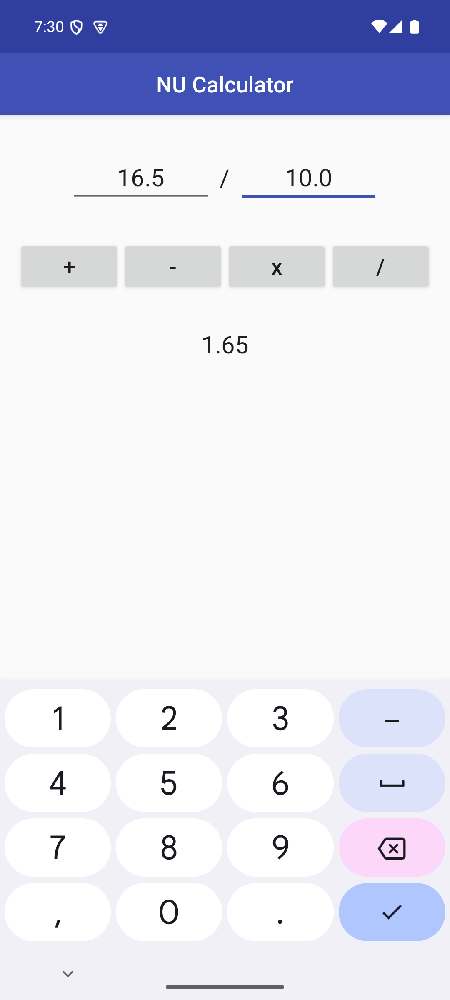
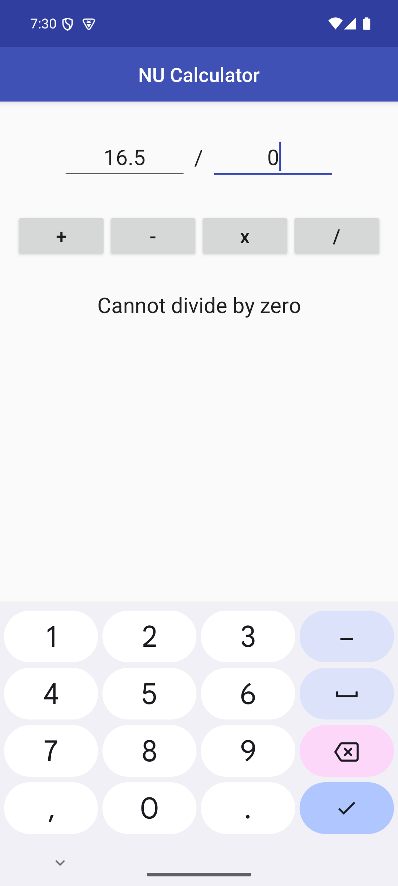

# NUapp

Assignment 2a: a tiny calculator Android app (Java). The screen has two number boxes and four
buttons. Type two numbers, press `+`, `-`, `x` or `/`, and the answer appears below the buttons.
An empty box or a division by zero shows a message instead of an answer.
Labels and error messages are available in English and French (`values-fr`).

- Package: `edu.nu.helloworld`
- compileSdk / targetSdk 35, minSdk 24
- Android Gradle Plugin 8.13.2, Gradle 8.13
- Java code follows the [Google Java Style Guide](https://google.github.io/styleguide/javaguide.html)

## Run

Open the project in Android Studio and click Run, or:

```
./gradlew installDebug
```

| Add | Divide | Divide by zero |
| --- | --- | --- |
|  |  |  |
