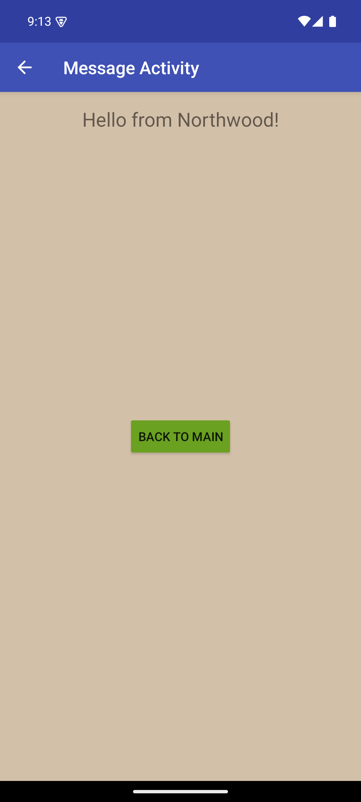
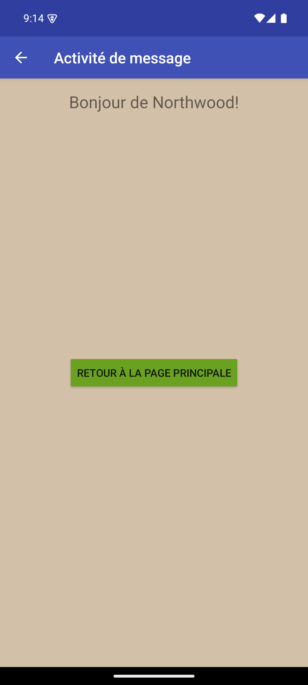

# NUapp

Assignment 1b: SendToScreen Android app (Java). The main screen has a message box and a
Send button; clicking Send opens Message Activity, which shows the message in a TextView.
All strings are available in English and French (`values-fr`).

- Package: `edu.nu.helloworld`
- compileSdk / targetSdk 35, minSdk 24
- Android Gradle Plugin 8.13.2, Gradle 8.13

## Run

Open the project in Android Studio and click Run, or:

```
./gradlew installDebug
```

| English | French |
| --- | --- |
|  |  |
