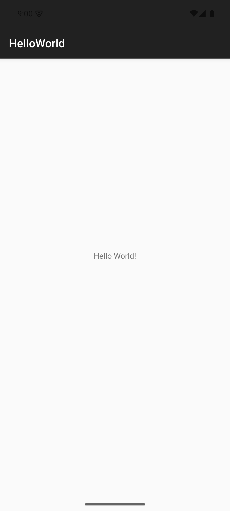

# NUapp

Assignment 1: Hello World Android app (Java). It shows "Hello World!" centered on the screen.

- Package: `edu.nu.helloworld`
- compileSdk / targetSdk 35, minSdk 24
- Android Gradle Plugin 8.13.2, Gradle 8.13

## Run

Open the project in Android Studio and click Run, or:

```
./gradlew installDebug
```


