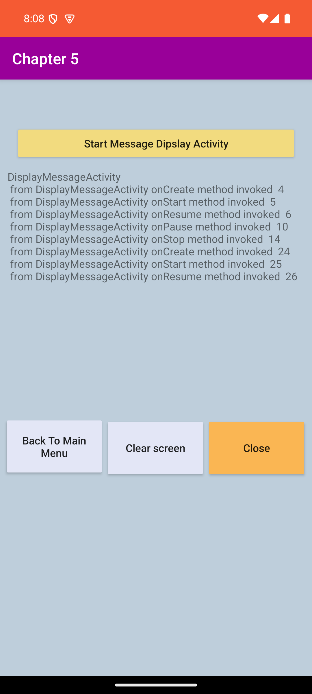
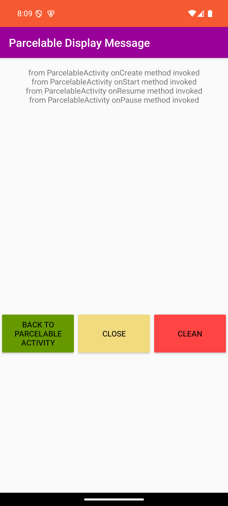

# Assignment 2b: LifeCycleWithParcellable

The Chapter 5 life cycle example app (Java), provided with the assignment. The first screen has
four buttons. This assignment runs the app and reproduces the order of the life cycle method calls
shown on the MainActivity screen.

The app is the one provided and it behaves the same. The Java code was reformatted to follow the
[Google Java Style Guide](https://google.github.io/styleguide/javaguide.html) and comments were
added. The Gradle build files were updated so the project builds with the current Android Studio.

## Steps to reproduce the method order

1. On the first screen press **2. Life Cycle Demonstration**.
2. Press **Start Message Dipslay Activity**.
3. Press **Back to Main Activity**.
4. Press **Back To Main Menu**.
5. Press **2. Life Cycle Demonstration** again.
6. Press **Start Message Dipslay Activity** again.
7. Press **Back to Main Activity** again.

The MainActivity screen now lists the DisplayMessageActivity methods in the order they ran:
onCreate 4, onStart 5, onResume 6, onPause 10, onStop 14, onCreate 24, onStart 25, onResume 26.

The assignment picture shows onStop 15 where this run shows onStop 14. Since Android 9,
`onSaveInstanceState()` runs after `onStop()` instead of before it, so the counter is one lower
when `onStop()` is recorded. The order of the method calls is the same.

| First screen | Life cycle method order | Parcelable method order |
| --- | --- | --- |
|  |  |  |

## Run

Open this folder in Android Studio and click Run, or:

```
./gradlew installDebug
```
